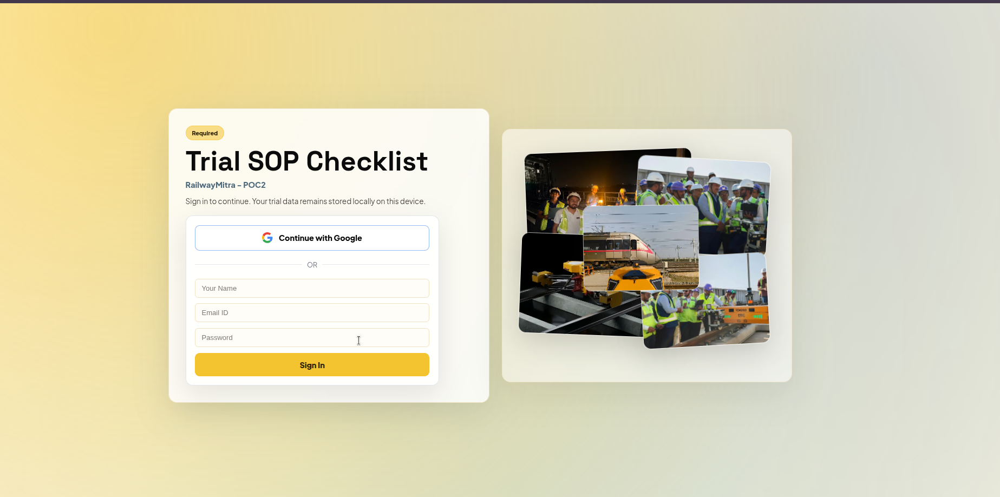
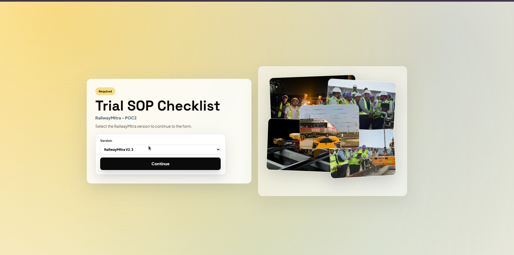
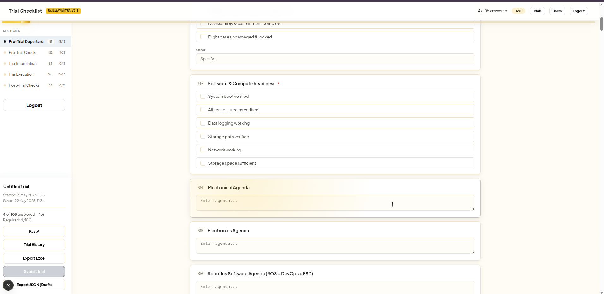
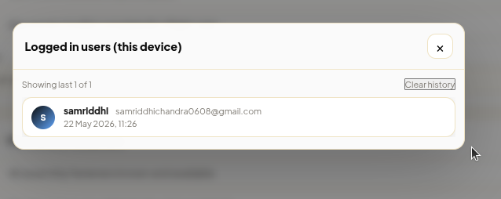
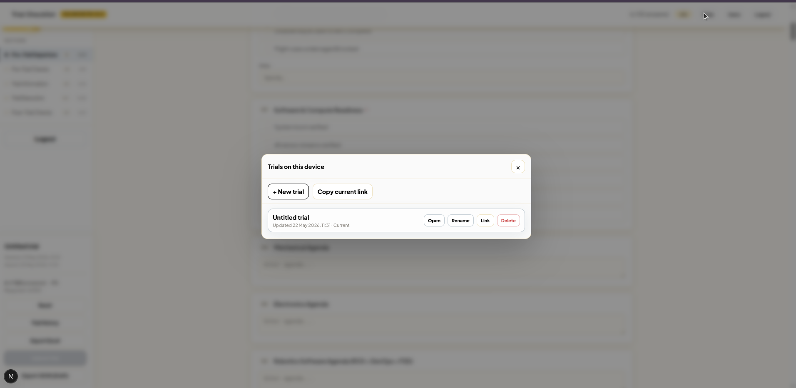
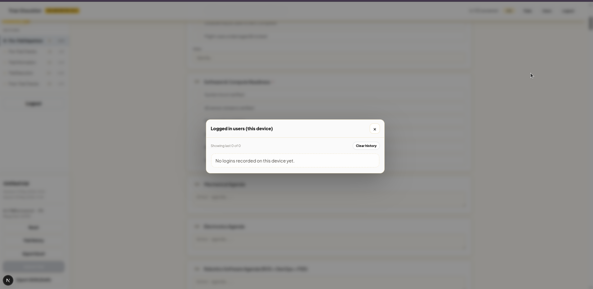
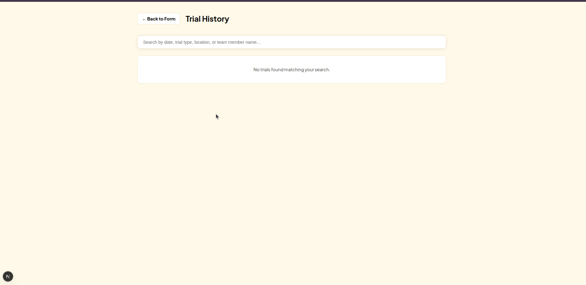

# Trial SOP Checklist

Sectioned Trial SOP checklist web app with **local-first autosave**, **multi-trial resume**, and **exports (JSON and Excel)**.

## Demo (Screenshots)

<table>
  <tr>
    <td></td>
    <td></td>
  </tr>
  <tr>
    <td></td>
    <td></td>
  </tr>
  <tr>
    <td></td>
    <td></td>
  </tr>
  <tr>
    <td colspan="2"></td>
  </tr>
</table>

## Why This App

Trial data entry is often **irregular**:
- Some sections are filled in the office.
- Later sections are filled on-track at different times.
- Connectivity can be weak or intermittent.

This app is built to **retain trial state safely** so the operator can continue later without losing progress.

## Key Features

- Sectioned checklist flow with **progress** and **required** indicators
- **Autosave** to the shared database with a local browser cache
- **Shared trials and history** available to every signed-in employee
- Resume via URL: `/form?trialId=...`
- **Exports**: JSON and formatted Excel workbooks
- **Login** via employee code (verified against PostgreSQL)
- **Trial management**: create, rename, resume, delete trials
- **Version / Robot name** and **custom Trial ID** fields
- **105 questions** across 5 sections with 7 question types (text, textarea, time, date, select, yes/no with required notes, checklist with free-text)
- Time questions with **"Tap to record"** and **edit tracking** (reason required)
- **Blocking issues validation** before submission
- **Trial history** page with search/filter
- Mobile-friendly UI (collapsible actions on small screens)

## Tech Stack

- Next.js (App Router)
- React
- Neon PostgreSQL — employee verification and shared trial storage

## Getting Started

### Prerequisites

- Node.js 20.9+ (required by Next.js 16)
- A Neon PostgreSQL database (or another compatible Neon HTTP endpoint)

### Install

```bash
npm ci
```

### Configure Employee Database

Create a PostgreSQL database in the [Neon Console](https://console.neon.tech/) and copy its pooled connection string into `.env.local` as `DATABASE_URL`. Keep this connection string private. Copy `.env.example` to `.env.local` and set `AUTH_SECRET` to a new random value of at least 32 characters.

The app creates the `employees` and shared `trials` tables automatically. The employee table stores employee code, name, designation, and (when entered with the protected script below) encrypted Aadhaar. Add an active employee for local testing with SQL such as:

```sql
INSERT INTO employees (employee_code, name, designation)
VALUES (UPPER('YOUR_EMPLOYEE_CODE'), 'Your Name', 'Your Designation')
ON CONFLICT (employee_code) DO UPDATE
SET name = EXCLUDED.name, designation = EXCLUDED.designation;
```

The employee directory list is maintained in `scripts/seed-employees.js`. Review the codes before running `npm run seed:employees` against a database: it inserts or updates only the listed employees and does not delete or deactivate employees omitted from the list.
The Trial Agenda team-member dropdown reads active employees from this table, excluding employee codes `16055` and `16064` from that dropdown only; this does not disable their login.

### Adding Aadhaar securely

The app stores employee Aadhaar encrypted with AES-256-GCM in the `employees.aadhaar_ciphertext` column. The Trial Agenda employee dropdown displays only the last four digits. External member Aadhaar entered on a trial is encrypted before it is stored in the shared database. Create a random 32-byte encryption key:

```bash
node -e "console.log(require('crypto').randomBytes(32).toString('base64'))"
```

Set the result as `AADHAAR_ENCRYPTION_KEY` in local `.env.local` and as a Cloudflare Worker secret. Keep the same key safe and stable; losing or changing it makes existing encrypted values unreadable. Set `DATABASE_URL` to the database you intend to update, then enter an employee's number using the hidden terminal prompt:

```bash
npm run set:employee-aadhaar -- 2401
```

Run this from the application folder. The prompt does not echo the digits. Do not paste Aadhaar into chat, source code, command arguments, SQL, or logs. Only collect and retain it if required by your organization's policy.

### Run (dev)

```bash
npm run dev
```

Open `http://localhost:3000`. You'll be redirected to `/login` — enter an active employee code to go directly to the Trial List at `/history`. New employees can register with their name and employee code. Their account remains inactive until an approver accepts the one-time link emailed to `reports@ericrobotics.com`; only then can they sign in. The approval link expires after 7 days. Use **+ New Trial Form** to open the form-version chooser, which welcomes the signed-in employee by name. Choosing a version resumes that employee's unfinished trial of that version on the same device, or starts a new trial if they have none. Set `DATABASE_URL`, `AUTH_SECRET`, and SMTP settings in `.env.local` before using registration.

## Usage

### Login

Open `/login` and enter your employee code. The code is verified server-side against PostgreSQL. The server issues a signed, HTTP-only session cookie; the browser's local employee cache is not used to authorize API requests.

### Trial List and Start / Resume a Trial

After signing in, employees open the checklist form directly. PMO employees can fill in the Trial Agenda first; after successfully submitting it, they are taken to the Trial List. The list shows trials only after the PMO has submitted the agenda. Use **New Trial Form** from the Trial List to start a fresh form, or open a published trial from the list.

- Click **Trials** to create a new trial, open a saved trial, rename a trial, copy a resume link, or delete a shared trial.
- Set a **version / robot name** and **custom Trial ID** via the header inputs.
- New Trial IDs receive a globally increasing serial number, shared across dates and checklist versions.
- Click the trial title to rename it inline.
- The Trial Agenda is editable only by PMO employees Vasundara (code `2440`) and Srishti (code `16080`); other employees can view it and complete the rest of the trial form. The server preserves agenda answers when non-PMO employees save a trial.
- The PMO user submits the agenda with **Submit Agenda** at the end of that section. After a successful publish, the PMO is returned to the Trial List. The published agenda is shared with other employees, appears read-only in their forms, and is copied into new trials.
- Enter separate **From** and **To** locations in the Trial Agenda. Press **Enter** to move through question fields; use **Shift+Enter** for a new line in a multiline answer.
- Use the **Submit** button at the bottom-right after the last form section to submit the full trial, including the agenda answers.
- Use **Print Acknowledgment** below the team members section to print or save the completed checklist as PDF. Printing is enabled after all questions are answered; employee Aadhaar values in the team table remain masked to the last four digits. Trolly and V2.2 use separate trial drafts.

### Trial List

Open `/history` to browse all trials shared by signed-in employees, with search/filter and Excel export.

### Reset / Export

- **Reset** clears the current trial's answers (keeps the same `trialId`).
- **Export Excel** downloads a formatted `.xlsx` workbook for the filtered history (or for an individual trial). The workbook includes a separate Trial Agenda sheet with internal activity and external report rows.
- Trial History displays the internal and external agenda entries as readable tables.
- **Export JSON (draft)** — snapshot without validation.
- **Export JSON (submission)** — validates required questions, "No" notes, and edited time reasons before exporting.

### Blocking Issues

Before submission, the app validates:
- All required questions are answered.
- "No" responses include a required note.
- Edited time entries include a required change reason.
Blocking issues are shown in a toast; submission is prevented until resolved.

## Emailing the Trial PDF on Submit

Click **Submit Post-Trial** to save the trial and send the full trial summary
and PDF report to the address(es) configured in `SOFTWARE_LEAD_EMAIL`.
Support-ticket email routing is unchanged.

Setup:

1. Copy `.env.example` to `.env.local`.
2. On Cloudflare Workers, the app uses Cloudflare Email Service automatically
   when the `EMAIL` binding is enabled. A Cloudflare account/domain admin must
   enable Email Sending and onboard the company sender domain once in Cloudflare;
   use a sender address on that domain (the default is
   `reports@ericrobotics.com`). This needs no Microsoft/Azure IDs or SMTP
   password. Locally, or on hosts without that binding, configure another
   provider as below.
3. For Microsoft 365, configure `MS_GRAPH_TENANT_ID`, `MS_GRAPH_CLIENT_ID`,
   `MS_GRAPH_CLIENT_SECRET`, `MS_GRAPH_FROM_EMAIL`, and the email recipient
   variables. Register an application in Microsoft Entra, grant Microsoft
   Graph **Application** permission `Mail.Send`, and have an administrator
   grant consent. The sender mailbox must be allowed by that app permission.
   For other SMTP providers, configure `SMTP_HOST`, `SMTP_PORT`,
   `SMTP_USER`, `SMTP_PASS`, and `MAIL_FROM` instead.
4. Set `SOFTWARE_LEAD_EMAIL` to the recipient(s) for trial report emails. Trial
   reports use this setting; support-ticket routing remains unchanged.
5. Restart the dev/production server so the new environment variables are picked up.

If email isn't configured (or the SMTP server rejects the send), the app
does **not** lose the submission: it shows the exact reason in the toast
(e.g. "Email is not configured on the server…", "Email login was
rejected…") and automatically downloads the generated PDF locally so it
can be sent manually.

Relevant files: `lib/generateTrialPdf.js` (PDF layout), `lib/mailer.js`
(Graph OAuth and SMTP delivery), `app/api/submit-trial/route.js` (API
route wiring the two together).

## Data Persistence Model

- The Neon PostgreSQL database is the source of truth for trials and history shared by all signed-in employees.
- Support tickets are stored in Neon PostgreSQL too, so every signed-in employee sees the same tickets. Ticket numbers are assigned by the database to avoid collisions when tickets are submitted at the same time. Tickets saved in a browser by older app versions are moved to the shared database when that browser next opens Support Tickets.
- Support tickets can include up to 10 photo/video attachments (25 MB total); files are stored with the shared ticket and linked from its ticket card.
- The browser keeps a local cache to support resuming and migration of existing local trials; clearing browser data does not delete database trials.
- Unpublished trial drafts are visible only to their owner and PMO accounts, including through direct trial links and API requests. After PMO submits the agenda, the trial becomes visible to all signed-in employees in the Trial List. Support tickets remain shared with all signed-in employees.
- Employee records, signed-session validation, trials, and support tickets are stored in Neon PostgreSQL.

## Deploying to Cloudflare Workers

This is a server-rendered Next.js app with API routes, so deploy it to
**Workers** using the OpenNext adapter; a static Pages export will not support
its login, database, and submission routes.

1. Open a terminal in this app directory (the folder containing `package.json`)
   and install the locked dependencies with `npm ci`.
2. Log in to your Cloudflare account from the CLI with `npx wrangler login`.
   This links the CLI to the account shown in the Cloudflare dashboard.
3. Add these **Worker secrets** in the Cloudflare dashboard under
   **Workers & Pages → rlm-checklist → Settings → Variables and Secrets**, or
   set them with `npx wrangler secret put <NAME>`:
   - `DATABASE_URL`: the pooled Neon PostgreSQL connection string.
   - `AUTH_SECRET`: a unique random value of at least 32 characters. Keep it
     stable across deployments or existing login sessions will be invalidated.
   - `AADHAAR_ENCRYPTION_KEY`: a unique base64-encoded 32-byte key. Keep it
     stable and available to the terminal script when saving encrypted Aadhaar.
   - Cloudflare Email Service is configured by the `EMAIL` binding in
     `wrangler.jsonc`; have a Cloudflare account/domain admin enable Email
     Sending and onboard `ericrobotics.com` once. Set `MAIL_FROM` to an
     onboarded sender address if it differs from `reports@ericrobotics.com`.
     No mail provider IDs or SMTP password are needed for this option.
   - For Microsoft 365 email, set `MS_GRAPH_TENANT_ID`, `MS_GRAPH_CLIENT_ID`,
     `MS_GRAPH_CLIENT_SECRET`, and `MS_GRAPH_FROM_EMAIL`. The Entra app needs
     Microsoft Graph **Application** permission `Mail.Send` with admin consent.
     For SMTP providers, set `SMTP_HOST`, `SMTP_PORT`, `SMTP_SECURE`,
     `SMTP_USER`, `SMTP_PASS`, and `MAIL_FROM`. Set `MAIL_TO` for trial PDF
     email. Support-ticket routing can also
     use `TEAM_LEAD_EMAILS`, `HARDWARE_LEAD_EMAIL`, and `SOFTWARE_LEAD_EMAIL`.
     Employee-registration notices go to `reports@ericrobotics.com`. Set
     `APP_BASE_URL` to the deployed HTTPS origin so manager approval links point
     to the live Worker.
     Keep these private; do not commit them to source control.
4. Add active employees to the same Neon database (the SQL example above
   applies). If using `npm run seed:employees`, review the employee list first.
5. Test in Cloudflare's Workers runtime with `npm run preview:cloudflare`.
   Deploy with `npm run deploy:cloudflare`. The app will be available at its
   `*.workers.dev` URL; share `/form` with employees.

The deployment config is in `wrangler.jsonc` and `open-next.config.ts`.
`nodejs_compat` is enabled for the server-side PDF and email dependencies.
Cloudflare uses Worker secrets rather than `.env.local`; never put production
secrets in `wrangler.jsonc`.

The app is hosted on Cloudflare Workers, but its employee and trial database is
Neon PostgreSQL (configured by `DATABASE_URL`), not a Cloudflare D1 database.
After deploying these code changes, the app adds the new columns automatically
on its next database initialization. Local source edits do not update the live
Worker; deploy with `npm run deploy:cloudflare` (or push through a configured
automatic Git deployment).

## Deploying to GitHub and Vercel

1. Push this app directory (the folder containing `package.json`) to a private company GitHub repository. Do not commit `.env.local`, database URLs, SMTP passwords, or other secrets.
2. In Vercel, import the repository. If the repository contains the parent folder too, set **Root Directory** to `rlm_checklist_shared-feat-simple_login`; otherwise use the repository root.
3. Create or select a Neon PostgreSQL database. Add the following Vercel Environment Variables for Production (and Preview if needed):
   - `DATABASE_URL`: the Neon pooled connection string.
   - `AUTH_SECRET`: a unique random value of at least 32 characters (generate with `openssl rand -base64 48`). Keep the same value across deployments.
4. Add the company's employee codes to the Neon `employees` table. The app creates its tables on first server use. For each employee, run:

   ```sql
   INSERT INTO employees (employee_code, name, designation)
   VALUES (UPPER('EMPLOYEE_CODE'), 'Employee Name', 'Designation')
   ON CONFLICT (employee_code) DO UPDATE
   SET name = EXCLUDED.name, designation = EXCLUDED.designation;
   ```

   Only active employee codes in this database can sign in. Do not seed the sample codes in production.
5. For Microsoft 365 email, configure the Graph OAuth variables listed above and the recipient variables. For another SMTP provider, set its SMTP variables. Leave mail variables out to disable email; submissions still download a PDF if sending is unavailable.
6. Deploy. After deployment, share `https://YOUR-VERCEL-DOMAIN/form` with the team. Employees sign in with the active codes added above. Their trials and Trial History are stored in the shared database.

After changing environment variables, redeploy the Vercel project so the deployment picks them up.

## Scripts

- `npm run dev` — start dev server
- `npm run build` — production build (`NEXT_USE_WEBPACK=1`)
- `npm start` — run production server
- `npm run lint` — run ESLint
- `npm run seed:employees` — insert or update the employee list in the configured PostgreSQL database
- `npm run set:employee-aadhaar -- <employee-code>` — enter an Aadhaar number through a hidden prompt and save it encrypted to the configured PostgreSQL database

## Project Structure

- `app/page.js` — root route (redirects to `/login`)
- `app/layout.js` — root layout (AuthProvider wrapper, font loading)
- `app/globals.css` — global stylesheet
- `app/login/page.js` / `LoginClient.jsx` — login route (employee code entry)
- `app/form/page.js` / `FormClient.jsx` / `ProtectedForm.jsx` — checklist form route (auth-protected)
- `app/history/page.js` / `HistoryClient.jsx` — trial history route with search/filter
- `app/select/page.js` — legacy redirect to `/form`
- `app/api/verify-employee/route.js` — employee code verification API (PostgreSQL)
- `app/components/ChecklistApp.jsx` — checklist UI + autosave + exports + trial switcher
- `app/components/AuthProvider.jsx` — auth context (employee code login via API)
- `lib/checklistData.js` — 105 questions across 5 sections, all question type definitions
- `lib/checklistStorage.js` — trial persistence helpers
- `lib/db.js` — Neon PostgreSQL connection and schema initialization
- `scripts/seed-employees.js` — PostgreSQL employee directory seeder
- `scripts/set-employee-aadhaar.mjs` — hidden-prompt Aadhaar encryption and update
- `public/demo1.png` … `public/demo7.png` — README screenshots

## Deployment

For Vercel, import the GitHub repository with the app directory as the Root Directory if needed. Add `DATABASE_URL` and the SMTP variables from `.env.example` in the Vercel project settings. For Cloudflare Workers, follow the [Cloudflare deployment steps](#deploying-to-cloudflare-workers).

```bash
npm ci
npm run build
npm start
```

## License

Private / internal project (update if you intend to open source).
